<!-- ░░ PLAYER 1 READY ░░  design inspired by https://abhishekms-portfolio-page.vercel.app -->

  <a href="https://abhishekms-portfolio-page.vercel.app/">
    
  </a>

  
  
  
  

 


  


  

<code>+ WebSockets</code> &nbsp;·&nbsp; <code>+ real-time multiplayer</code> &nbsp;·&nbsp; <code>+ AI features that ship</code>


<a href="https://main.d3skpx6qxc85hh.amplifyapp.com/">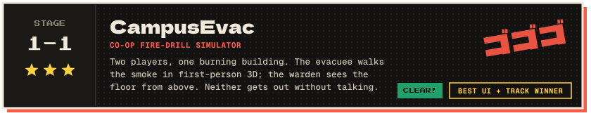</a>

<a href="https://main.d3skpx6qxc85hh.amplifyapp.com/">▶ PLAY</a> &nbsp;·&nbsp; <a href="https://github.com/abhishiv17/AWS">⌨ SOURCE</a> &nbsp;·&nbsp; Next.js · Three.js · AWS AppSync · DynamoDB

<a href="https://3o3ntcusu2.execute-api.ap-south-1.amazonaws.com/">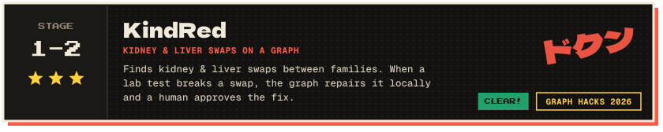</a>

<a href="https://3o3ntcusu2.execute-api.ap-south-1.amazonaws.com/">▶ PLAY</a> &nbsp;·&nbsp; <a href="https://github.com/abhishiv17/Graph-hacks">⌨ SOURCE</a> &nbsp;·&nbsp; <a href="https://abhishekms-portfolio-page.vercel.app/blog/kindred-when-a-kidney-swap-breaks-the-graph-finds-another-way-built-on-falkordb-27di">📜 WRITE-UP</a> &nbsp;·&nbsp; FalkorDB · TypeScript · AWS

<a href="https://main.d25xaqqlm27lpb.amplifyapp.com/">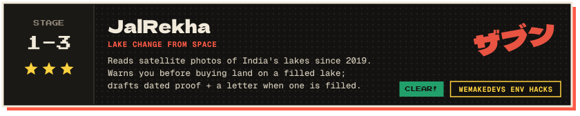</a>

<a href="https://main.d25xaqqlm27lpb.amplifyapp.com/">▶ PLAY</a> &nbsp;·&nbsp; <a href="https://github.com/abhishiv17/JalRekha">⌨ SOURCE</a> &nbsp;·&nbsp; Satellite imagery · TypeScript · AWS Amplify

<a href="https://hair-path-youcam.vercel.app/">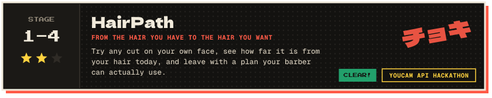</a>

<a href="https://hair-path-youcam.vercel.app/">▶ PLAY</a> &nbsp;·&nbsp; <a href="https://github.com/abhishiv17/HairPath">⌨ SOURCE</a> &nbsp;·&nbsp; YouCam AI try-on · TypeScript · Vercel

<a href="https://skill-swap-p.vercel.app/">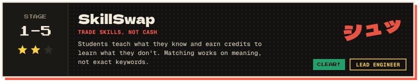</a>

<a href="https://skill-swap-p.vercel.app/">▶ PLAY</a> &nbsp;·&nbsp; <a href="https://github.com/abhishiv17/SkillSwapP">⌨ SOURCE</a> &nbsp;·&nbsp; Semantic matching · TypeScript · Vercel

<b>🕹️ Bonus levels</b> — more cartridges from the shelf

 

| Cartridge | What it is |
|---|---|
| [**GrudgeBound**](https://github.com/abhishiv17/GrudgeBound) | Unreal Engine 5 game where greed spawns monsters and players vote in the rules, enforced by NEAR contracts. Built at NEAR Hackathon. |
| [**Blind-Run**](https://github.com/abhishiv17/Blind-Run) | *One Heist, Two Realities* — asymmetric multiplayer heist in React Three Fiber + Rapier. One player walks the building blind. |
| [**DataExit**](https://github.com/abhishiv17/DataExit) | DPDP data-rights agent built on MCP servers, with voice, live on AWS Lambda. |
| [**Cerebyte**](https://github.com/abhishiv17/Cerebyte) | Learn DSA & DBMS with a code execution engine, an AI tutor and visual ER diagrams. |


  


  <a href="https://github.com/pulls?q=is%3Apr+author%3Aabhishiv17+-user%3Aabhishiv17">
    
  </a>

<a href="https://github.com/afreenorbit/hermit">hermit</a> &nbsp;·&nbsp; <a href="https://github.com/topoteretes/cognee-community">cognee-community</a> &nbsp;·&nbsp; <a href="https://github.com/HackUnitedOrg/hackunited-org">hackunited-org</a>


> 📜 **[What a 14-day Freshdesk trial taught me about building a cognee connector](https://abhishekms-portfolio-page.vercel.app/blog/what-a-14-day-freshdesk-trial-taught-me-about-building-a-cognee-connector-4ldc)** `31 OCT 2026 · 10 MIN`
>
> 📜 **[KindRed: when a kidney swap breaks, the graph finds another way](https://abhishekms-portfolio-page.vercel.app/blog/kindred-when-a-kidney-swap-breaks-the-graph-finds-another-way-built-on-falkordb-27di)** `18 OCT 2026 · 16 MIN`
>
> 📜 **[Mergetober part 2: my plan was wrong twice, and a free trial caught it before the code did](https://abhishekms-portfolio-page.vercel.app/blog/mergetober-part-2-my-plan-was-wrong-twice-and-a-free-trial-caught-it-before-the-code-did-22g9)** `14 OCT 2026 · 6 MIN`


  <picture>
    <source media="(prefers-color-scheme: dark)" srcset="https://raw.githubusercontent.com/abhishiv17/abhishiv17/output/snake-dark.svg" />
    <source media="(prefers-color-scheme: light)" srcset="https://raw.githubusercontent.com/abhishiv17/abhishiv17/output/snake-light.svg" />
    
  </picture>

  

 


  
  
  
  
  

  

