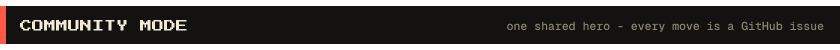
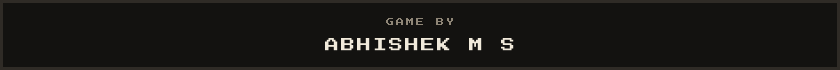

  

  

 

<!--GAME:START-->

no moves yet — be player one 👾

<!--GAME:END-->

   
   
  

press an arrow → click the green <b>Create</b> button on the page that opens → come back & refresh in ~30s

<b>📖 Rules</b> (same in both modes)

 

| | |
|---|---|
| 🐛 walk into a bug | squash it **+10** (orange bugs have armor: two hits) |
| 🪙 coin | **+5** |
| 🪜 stairs | next level **+25** and **+1 ❤️** — more bugs every floor |
| 😬 bugs next to you | might bite **−1 ❤️** after every move |
| 💀 0 ❤️ | game over. the score goes to the hi-score table and a new run starts |

 

  <picture>
    <source media="(prefers-color-scheme: dark)" srcset="https://raw.githubusercontent.com/abhishiv17/abhishiv17/output/snake-dark.svg" />
    <source media="(prefers-color-scheme: light)" srcset="https://raw.githubusercontent.com/abhishiv17/abhishiv17/output/snake-light.svg" />
    
  </picture>
   🐍 BONUS STAGE — the snake eats my commits

 

  
   
  
  
  

